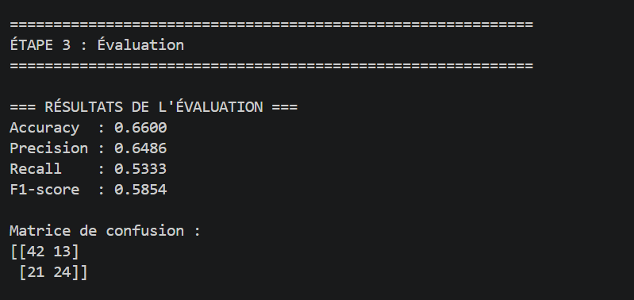
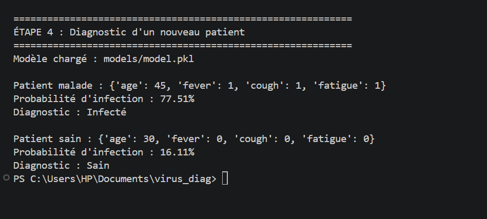

# Virus Diag 🦠

Système de diagnostic médical basé sur l'IA pour détecter l'infection virale chez un patient.

## Architecture

- `core/` : logique métier (dataset, modèles)
- `utils/` : outils (prétraitement)
- `pipeline/` : orchestration (entraînement, prédiction)
- `app/` : API et interface
- `data/` : données patients

## Installation

```bash
pip install pandas scikit-learn

## 📊 Résultats

### Évaluation du modèle
Voici les performances du modèle (Accuracy, Precision, Recall, F1-score) sur l'ensemble de test :



### Prédiction en temps réel
Voici le résultat du diagnostic pour deux patients fictifs (un malade et un sain), démontrant que la condition `>= 0.5` est bien appliquée dans le `main.py` :

